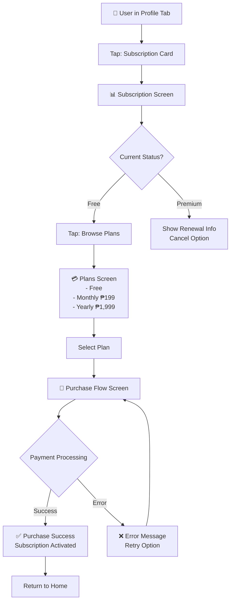

# 🛒 How to Navigate to Billing in Land Finder

## **Quick Answer**
Users can access billing/subscription in **3 main ways**:

---

## **Method 1️⃣: Via Profile Tab (PRIMARY)**

### **Path:**
```
Home Screen 
  ↓ Tab: Profile
    ↓ Card: "Subscription" (with workspace_premium icon)
      ↓ Shows current plan + expiry date
        ↓ Tap on card
          → Subscription Screen (Full billing interface)
```

### **UI Location:**
- **Screen**: `ProfileTab` (bottom navigation)
- **Component**: ListTile card with:
  - Icon: `Icons.workspace_premium_outlined` 🏆
  - Title: "Subscription"
  - Subtitle: Shows current plan (e.g., "Free" or "Monthly until Dec 15, 2025")
  - Trailing: Chevron icon (➜)

### **Code Reference:**
File: `lib/features/profile/presentation/screens/profile_tab.dart:160-178`
```dart
ListTile(
  leading: const Icon(Icons.workspace_premium_outlined),
  title: const Text('Subscription'),
  subtitle: Text(
    profile.isPremium
        ? '${profile.planName} until ${formatSubscriptionDate(profile.expiresAt)}'
        : 'Current plan: ${profile.planName}',
  ),
  trailing: const Icon(Icons.chevron_right),
  onTap: () {
    Navigator.push(
      context,
      MaterialPageRoute(
        builder: (context) => const SubscriptionPage(),
      ),
    );
  },
)
```

---

## **Method 2️⃣: Via Home Tab Upgrade Sheet (CONTEXTUAL)**

### **Path:**
```
Home Screen (Browse properties)
  ↓ Tap "View Plans" button (on upgrade prompts)
    or
  Trigger premium feature gate
    ↓ 
      → Subscription Screen
        ↓ Shows available plans with pricing
          ↓ Tap plan → Purchase Flow Screen
```

### **When It Appears:**
- User browses properties without premium
- UI shows "Upgrade to Premium" prompts
- "View Plans" button available in multiple locations:
  - Home tab subscription prompt card
  - Saved properties overflow sheet
  - Search results limitations
  - Property details restrictions

### **Code Triggers:**
File: `lib/features/home/presentation/screens/home_page.dart`
```dart
Future<void> _openSubscriptionPage() async {
  await openSubscriptionPage(context);
}

// Triggered by:
// - onViewPlans: _openSubscriptionPage
// - onOpenSubscription: _openSubscriptionPage
```

**Helper Function:**
File: `lib/features/subscription/presentation/navigation/subscription_navigation.dart`
```dart
Future<void> openSubscriptionPage(BuildContext context) {
  return Navigator.push(
    context,
    MaterialPageRoute(builder: (context) => const SubscriptionPage()),
  );
}
```

---

## **Method 3️⃣: Via Specific Feature Premium Gates (EMBEDDED)**

### **Locations:**
Several features show "Upgrade Required" prompts with direct links:

#### **A) Agent Teams Page**
- File: `lib/features/agent_teams/presentation/screens/agent_teams_screen.dart`
- Shows: `_PremiumGate` widget
- Action: Tap "Upgrade" → Opens subscription page

#### **B) Property Details Screen**
- File: `lib/features/properties/presentation/screens/property_details_screen.dart`
- Shows: Premium feature restrictions
- Action: Tap "Upgrade" button → Opens subscription page

#### **C) Saved Properties Tab**
- File: `lib/features/properties/presentation/screens/saved_tab.dart`
- Shows: Save more than 3 properties message
- Action: Tap "Upgrade Now" → Opens subscription page

#### **D) Map Screen**
- File: `lib/features/map/presentation/screens/map_screen.dart`
- Shows: Premium map features unavailable
- Action: Tap "Upgrade" → Opens subscription page

#### **E) Search Results**
- File: `lib/features/search/presentation/screens/property_search_results_screen.dart`
- Shows: Filter limitations for free users
- Action: Tap "View More" → Opens subscription page

---

## **Complete Billing Screen Flow**

### **1. Subscription Screen (SubscriptionPage)**
**Shows:**
- Current subscription status
- Next renewal date
- Remaining premium days
- Action buttons:
  - "Browse Plans" → Plans Screen
  - "Restore Purchases" (if purchased before)
  - "Cancel Subscription" (if premium)

**File:** `lib/features/subscription/presentation/screens/subscription_screen.dart`

### **2. Plans Screen (PlansScreen)**
**Shows:**
- **Free Plan** ₱0
  - Browse lot listings
  - Message agents
  - Save up to 3 lots

- **Monthly Plan** ₱199/month
  - Unlimited saved lots
  - Premium-only features
  - Premium analytics

- **Yearly Plan** ₱1,999/year
  - Everything in Monthly
  - Save up to 2 years
  - Best value

**File:** `lib/features/subscription/presentation/screens/plans_screen.dart`

### **3. Purchase Flow Screen (PurchaseFlowScreen)**
**Shows:**
- Plan summary (title, price, billing cycle)
- Features list for selected plan
- Real-time purchase status:
  - Processing ⏳
  - Success ✅
  - Error ❌
- Retry mechanism
- Help/support links

**File:** `lib/features/subscription/presentation/screens/purchase_flow_screen.dart`

### **4. Purchase Success Screen (PurchaseSuccessScreen)**
**Shows:**
- Confirmation message
- Subscription details:
  - Plan name
  - Price paid
  - Expiry date
  - Renewal info
- "Start Browsing" button to return home

**File:** `lib/features/subscription/presentation/screens/purchase_success_screen.dart`

---

## **Navigation Routes (Technical)**

All routes defined in: `lib/app/router/route_names.dart`

```dart
static const subscription = '/subscription';  // SubscriptionScreen
static const plans = '/plans';                // PlansScreen
```

Accessible via:
```dart
Navigator.pushNamed(context, RouteNames.subscription);
Navigator.pushNamed(context, RouteNames.plans);
```

---

## **User Journey: Free → Premium**



---

## **Premium Feature Gates (Where Billing is Triggered)**

| Feature | Location | Restriction | Upgrade Path |
|---------|----------|------------|--------------|
| **Save Properties** | Saved Tab | 3 properties max | "Save More" → Subscription |
| **Property Details** | Property Screen | View full details | Premium badge → Subscription |
| **Agent Teams** | Teams Screen | View teams only | Join button → Subscription |
| **Advanced Filters** | Filter Screen | Limited filters | "Unlock Filters" → Subscription |
| **Search Advanced** | Search Results | Basic search only | "Advanced" badge → Subscription |
| **Map Features** | Map Screen | Standard map only | "Premium Map" → Subscription |

---

## **Code Entry Points for Developers**

### **To Add Billing Button to New Feature:**
```dart
import '../../subscription/presentation/navigation/subscription_navigation.dart';

// Simple way:
onTap: () => openSubscriptionPage(context);

// Or full route:
Navigator.pushNamed(context, RouteNames.subscription);
```

### **To Check User Premium Status:**
```dart
import '../../subscription/data/services/subscription_service.dart';

// Check in controller:
if (!SubscriptionService.isPremium) {
  await openSubscriptionPage(context);
  return;
}
```

### **To Handle Post-Purchase:**
```dart
// After successful purchase:
// 1. SubscriptionPage shows updated status
// 2. Global app state updates (appSubscriptionNotifier)
// 3. UI automatically reflects premium features
// 4. User redirected to browse page or feature
```

---

## **Testing Billing Flow (Device)**

1. ✅ Ensure app is running: `flutter run`
2. ✅ Navigate to Profile Tab (bottom nav)
3. ✅ Tap "Subscription" card
4. ✅ See current plan (should be "Free" initially)
5. ✅ Tap "Browse Plans" button
6. ✅ See three plan options
7. ✅ **IMPORTANT**: Purchase flow not fully functional yet:
   - ⚠️ Google Play/App Store integration incomplete
   - ⚠️ Real receipts not verified
   - ⚠️ Payments go to sandbox/test stores
8. ✅ Expected in Phase 2.6: Controller integration with real payments

---

## **Current Phase Status** 🚀

✅ **Phase 2.5: UI & Services Complete**
- Subscription screen: ✅ Fully implemented
- Plans screen: ✅ Fully implemented
- Purchase flow: ✅ UI ready
- Purchase success: ✅ UI ready
- Navigation: ✅ All routes connected

⏳ **Phase 2.6: Controller Integration (Next)**
- Wire services to controllers: 🔄 Pending
- Real payment processing: 🔄 Pending
- Backend verification: 🔄 Pending

⏳ **Phase 2.7: Store Configuration**
- Google Play Console setup: 🔄 Pending
- App Store Connect setup: 🔄 Pending
- Test accounts: 🔄 Pending

⏳ **Phase 2.8+: Real Payments**
- Google Play verification: 🔄 Pending
- App Store verification: 🔄 Pending
- Production deployment: 🔄 Pending

---

## **Summary**

**Primary Entry Point:** Profile Tab → Subscription Card  
**Current State:** UI fully ready, backend integration in progress  
**Next Step:** Phase 2.6 to connect purchase handler to controllers  
**User Impact:** Currently shows screens and UI; actual purchases will work in Phase 2.8+  

