# Kogihan sa Negros user flow

This is the editable source for `mockups/app_user_flow/index.html`.

## Update the flow

1. Add or edit a node and arrow below.
2. Run **Tasks: Run Task → Update app user-flow preview**.
3. Refresh the browser.

Preview this file on GitHub or in VS Code with `Ctrl+Shift+V`.

```mermaid
flowchart LR
    splash["Splash / Bootstrap"]:::complete
    onboarding["Guest onboarding"]:::complete
    auth["Login / Register"]:::complete
    recovery["Password recovery"]:::integration

    home["Buyer Home"]:::complete
    map["Map"]:::integration
    saved["Saved"]:::integration
    inbox["Inbox"]:::integration
    profile["Profile"]:::integration

    search["Search & Filter"]:::complete
    details["Property Details"]:::complete
    gallery["Gallery"]:::complete
    contact["Contact Agent"]:::integration
    chat["Buyer Chat"]:::integration

    limit["Saved Limit"]:::integration
    plans["Subscription Plans"]:::integration
    purchase["Purchase / Verify"]:::integration
    restore["Restore / Manage"]:::integration
    paymongoMethods["PayMongo Methods"]:::blocked
    paymongoCheckout["PayMongo Checkout"]:::blocked
    paymongoVerify["Order / Webhook Verify"]:::blocked

    agent["Agent Dashboard"]:::guarded
    create["Create Listing"]:::guarded
    manage["Manage Listings"]:::guarded
    agentInbox["Buyer Inbox"]:::guarded
    teams["Teams"]:::guarded

    admin["Admin Dashboard"]:::guarded
    moderation["Moderation"]:::guarded

    splash -->|"first run"| onboarding
    onboarding -->|"sign in"| auth
    auth -->|"forgot"| recovery
    onboarding -->|"continue guest"| home
    auth -->|"buyer"| home
    home -->|"tab"| map
    home -->|"tab"| saved
    home -->|"tab"| inbox
    home -->|"tab"| profile
    home -->|"discover"| search
    search -->|"select"| details
    map -->|"marker"| details
    saved -->|"open"| details
    details -->|"save"| saved
    details -->|"media"| gallery
    details -->|"inquire"| contact
    contact -->|"thread"| chat
    inbox -->|"open"| chat
    saved -->|"at limit"| limit
    limit -->|"upgrade"| plans
    plans -->|"choose plan"| purchase
    plans -->|"existing buyer"| restore
    purchase -->|"unlocked"| saved
    restore -->|"restored"| profile
    purchase -->|"not connected"| paymongoMethods
    paymongoMethods -->|"not connected"| paymongoCheckout
    paymongoCheckout -->|"not connected"| paymongoVerify
    paymongoVerify -->|"not verified"| saved
    auth -->|"agent"| agent
    auth -->|"admin"| admin
    agent -->|"new"| create
    agent -->|"manage"| manage
    agent -->|"messages"| agentInbox
    agent -->|"team"| teams
    create -->|"submit"| moderation
    admin -->|"review"| moderation

    classDef complete fill:#123d31,stroke:#6ee7b7,color:#fff
    classDef integration fill:#4d391c,stroke:#f5b85c,color:#fff
    classDef guarded fill:#292e52,stroke:#9ca8ff,color:#fff
    classDef blocked fill:#45201e,stroke:#ef8d72,color:#fff
```



## Interactive preview details

The lines below are Mermaid-safe metadata comments. Copy an `@node` line
when adding a screen. Use the same ID as the Mermaid node. Separate multiple
actions with semicolons.

<!--
@node splash | lane=entry | slot=0 | role=entry | status=complete | icon=KB | route=/ | description=Initializes app state, restores the session, and selects the correct entry route. | actions=Resolve role and auth state;Route to onboarding or a workspace;Fallback unknown routes here | note=Verify cold start, deep link, stale-session, and offline behavior. | source=lib/app/bootstrap and route redirect
@node onboarding | lane=entry | slot=1 | role=entry | status=complete | icon=GO | route=/onboarding | description=Introduces the marketplace and lets a guest begin without an account. | actions=Continue to guest buyer view;Open login or registration | note=Confirm copy, permissions, skip behavior, and returning-user state. | source=lib/features/onboarding/presentation
@node auth | lane=entry | slot=2 | role=entry | status=complete | icon=ID | route=/login /register | description=Email authentication branch for buyer, agent, and administrator accounts. | actions=Choose login or create account;Recover a password;Resolve role-aware destination | note=Test invalid credentials, duplicate accounts, confirmation, and expired sessions. | source=lib/features/auth/presentation
@node recovery | lane=entry | slot=3 | role=entry | status=integration | icon=PW | route=/forgot-password | description=Requests an account recovery email and guides the user back to sign-in. | actions=Submit account email;Open reset link;Return to login | note=Verify email delivery, callback/deep-link setup, and reset expiration. | source=lib/features/auth/presentation

@node home | lane=shell | slot=0 | role=buyer | status=complete | icon=H | route=/home (Home tab) | description=Primary buyer-shell tab with featured properties, recent discovery, and entry points into search. | actions=Search and filter properties;Switch to Map, Saved, Inbox, or Profile | note=Check startup data, empty feed, pagination, and navigation-bar persistence. | source=lib/features/home/presentation
@node map | lane=shell | slot=1 | role=buyer | status=integration | icon=M | route=/home Map tab /map | description=Map-led property discovery shown as a buyer-shell tab. /map is also a direct route. | actions=Pan and inspect markers;Open property details | note=Test Mapbox token, network loss, permissions, marker density, and camera restoration. | source=lib/features/map/presentation
@node saved | lane=shell | slot=2 | role=buyer | status=integration | icon=♥ | route=/home Saved tab /favorites | description=Favorite-property screen shown as a buyer-shell tab. /favorites is also a direct route. | actions=Open a saved property;Remove favorite;Upgrade at limit | note=Validate backend sync, optimistic updates, guest restrictions, and limit messaging. | source=lib/features/favorites/presentation
@node inbox | lane=shell | slot=3 | role=buyer | status=integration | icon=IN | route=/home Inbox tab /inbox | description=Buyer conversation index shown as a tab. /inbox is also a direct named route. | actions=Open a conversation;Message the listing agent | note=Verify real-time delivery, unread counts, push notifications, and reconnect behavior. | source=lib/features/messaging/presentation
@node profile | lane=shell | slot=4 | role=buyer | status=integration | icon=P | route=/home Profile tab /profile | description=Account screen shown as a tab. /profile and /edit-profile are direct routes. | actions=Edit profile information;Manage subscription;Sign out | note=Check profile persistence, avatar upload, and authenticated account state. | source=lib/features/profile/presentation

@node search | lane=journey | slot=0 | role=buyer | status=complete | icon=⌕ | route=/search /property-search /property-filter | description=Searchable property inventory with registered search and filter screens. | actions=Apply filters;Open matching property;Reset search criteria | note=Exercise keyboard, empty results, clear/reset, and filter restoration. | source=lib/features/search and lib/features/properties/presentation
@node details | lane=journey | slot=1 | role=buyer | status=complete | icon=PD | route=/property-details + args | description=Focused listing view with land facts, media, asking price, location, and agent identity. | actions=View gallery;Save property;Contact the agent | note=Verify required PropertyDetailsArgs, stale inventory, long copy, and unavailable media. | source=lib/features/properties/presentation
@node gallery | lane=journey | slot=2 | role=buyer | status=complete | icon=▧ | route=/property-gallery + args | description=Full-screen media viewer opened with required PropertyGalleryArgs. | actions=Swipe through images;Return to details | note=Confirm caching, zoom, image failures, and swipe direction on actual devices. | source=lib/features/properties/presentation
@node contact | lane=journey | slot=3 | role=buyer | status=integration | icon=CA | route=/inquiries (internal inquiry action) | description=Inquiry screen plus inquiry creation from the property flow. | actions=Compose inquiry;Open buyer chat | note=Validate guest-to-login redirect, message creation, ownership, and offline submission. | source=lib/features/inquiries/presentation
@node chat | lane=journey | slot=4 | role=buyer | status=integration | icon=CH | route=/chat + ChatScreenArgs | description=One-to-one buyer and agent conversation with conversation context passed as arguments. | actions=Send and receive messages;Return to buyer inbox | note=Check delivery state, timestamps, long threads, attachment scope, and push deep links. | source=lib/features/messaging/presentation

@node limit | lane=upgrade | slot=2 | role=buyer | status=integration | icon=! | route=Internal entitlement gate (no route) | description=A conceptual gate within the saved-property and subscription experience. | actions=Review limit;View plans;Restore purchases | note=Verify entitlements, guest behavior, server truth, and no-billing bypass paths. | source=lib/features/subscription/presentation
@node plans | lane=upgrade | slot=3 | role=buyer | status=integration | icon=$ | route=/subscription /plans | description=Registered subscription and plans screens for store-managed purchase options. | actions=Select plan;Start purchase;Restore prior purchase | note=Test store availability, localized pricing, rejected products, and slow network responses. | source=lib/features/subscription/presentation
@node purchase | lane=upgrade | slot=4 | role=buyer | status=integration | icon=$✓ | route=In-screen step (native store) | description=Purchase controls and verification inside the subscription flow. | actions=Complete native purchase;Verify receipt;Unlock saved capacity | note=Use sandbox products and verify cancellation, duplicate receipts, refunds, and retry. | source=lib/features/subscription/data/services
@node restore | lane=upgrade | slot=5 | role=buyer | status=integration | icon=↺ | route=In-screen actions (no route) | description=Restore and store-management actions belonging to the subscription UI. | actions=Restore purchases;Open store management;Re-check entitlement | note=Confirm same-account restoration and behavior when the store has no transactions. | source=lib/features/subscription/presentation
@node paymongoMethods | lane=upgrade | slot=0 | role=buyer | status=blocked | icon=PM | route=Internal provider (Supabase function) | description=Loads available PayMongo methods through the get_billing_availability edge function. This branch is implemented but not verified as connected or deployed. | actions=Load enabled methods;Handle unavailable or disabled checkout | note=Verify the deployed function, authentication, secret configuration, and enabled-method flags. | source=lib/features/subscription/data/services/paymongo_billing_provider.dart
@node paymongoCheckout | lane=upgrade | slot=1 | role=buyer | status=blocked | icon=P$ | route=External PayMongo checkout (no app route) | description=Creates a billing checkout through Supabase and opens the PayMongo URL outside the app. | actions=Create checkout session;Open external browser;Return to app | note=Verify create_billing_checkout deployment, amount mapping, deep return, cancellations, and real sandbox payment. | source=lib/features/subscription/presentation/screens/purchase_flow_screen.dart
@node paymongoVerify | lane=upgrade | slot=6 | role=buyer | status=blocked | icon=✓? | route=Edge functions / webhook (no app route) | description=Polls billing order state and relies on webhook verification to update entitlement. End-to-end connection is not yet verified. | actions=Poll billing order;Receive webhook;Confirm entitlement | note=Verify get_billing_order, paymongo_webhook, signature validation, idempotency, and entitlement update. | source=supabase/functions and lib/features/subscription/data/services/paymongo_billing_provider.dart

@node agent | lane=agent | slot=0 | role=agent | status=guarded | icon=AD | route=/agent-dashboard | description=Agent-role-protected overview with listing, message, and team shortcuts. | actions=Create or manage listing;Open buyer inbox;Open teams | note=Test role guard, account switching, suspended agent state, and session expiry. | source=lib/features/agent/presentation
@node create | lane=agent | slot=1 | role=agent | status=guarded | icon=+L | route=/create-listing | description=Role-protected listing authoring flow for land details, pricing, and media. | actions=Draft listing;Upload media;Submit for moderation | note=Validate draft recovery, upload limits, required fields, and permission errors. | source=lib/features/agent/presentation
@node manage | lane=agent | slot=2 | role=agent | status=guarded | icon=ML | route=/manage-listings /edit-listing | description=Role-protected screens for owned listings and editing an existing property. | actions=Edit listing;Review moderation status;Pause or publish | note=Check ownership isolation, stale records, empty state, and destructive confirmations. | source=lib/features/agent/presentation
@node agentInbox | lane=agent | slot=3 | role=agent | status=guarded | icon=BI | route=/inbox /chat + args | description=Registered inbox and chat routes opened from the role-protected agent workspace. | actions=Open buyer conversation;Reply and mark read | note=Verify real-time updates, unread counts, role authorization, and push deep links. | source=lib/features/messaging/presentation
@node teams | lane=agent | slot=4 | role=agent | status=guarded | icon=TM | route=/agent-teams | description=Authenticated agent-team workspace. | actions=Review team access;Open team-specific tools | note=Validate membership changes, invitation state, and cross-team data boundaries. | source=lib/features/agent_teams/presentation

@node admin | lane=admin | slot=0 | role=admin | status=guarded | icon=AU | route=/admin-dashboard | description=Admin-only control surface for platform review and moderation activity. | actions=Open moderation queue;Inspect platform content | note=Enforce admin guard server-side and confirm non-admin deep-link denial. | source=lib/features/admin/presentation
@node moderation | lane=admin | slot=1 | role=admin | status=guarded | icon=RV | route=/moderation | description=Admin-role-protected review queue for submitted or reported property content. | actions=Approve or reject listing;Request changes;Return to admin dashboard | note=Test duplicate review, audit history, reason requirements, and author notification. | source=lib/features/admin/presentation

@journey | title=Guest discovers a property | short=Guest → home → search → details | nodes=splash,onboarding,home,search,details
@journey | title=Buyer saves a property | short=Details → saved → optional limit | nodes=home,search,details,saved,limit
@journey | title=Buyer messages an agent | short=Listing → inquiry → chat | nodes=home,search,details,contact,chat
@journey | title=Buyer upgrades | short=Limit → plans → purchase | nodes=saved,limit,plans,purchase
@journey | title=PayMongo checkout | short=Purchase → methods → checkout → verification (blocked) | nodes=plans,purchase,paymongoMethods,paymongoCheckout,paymongoVerify,saved
@journey | title=Agent creates a listing | short=Login → agent → create → moderation | nodes=auth,agent,create,moderation
@journey | title=Admin reviews content | short=Login → admin → moderation | nodes=auth,admin,moderation
-->

## Status and role values

- Status: `complete`, `integration`, `guarded`, `planned`, or `blocked`
- Role: `entry`, `buyer`, `agent`, or `admin`
- Lane: `entry`, `shell`, `journey`, `upgrade`, `agent`, or `admin`

## Command-line update

```powershell
dart run tool\update_user_flow.dart
```
